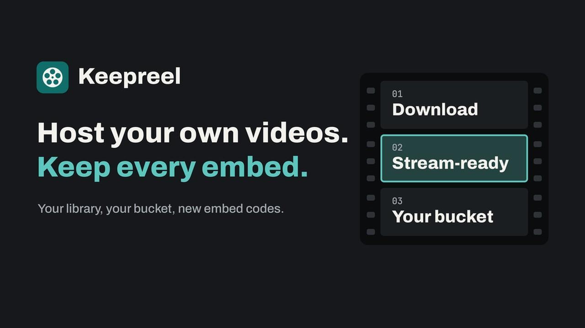
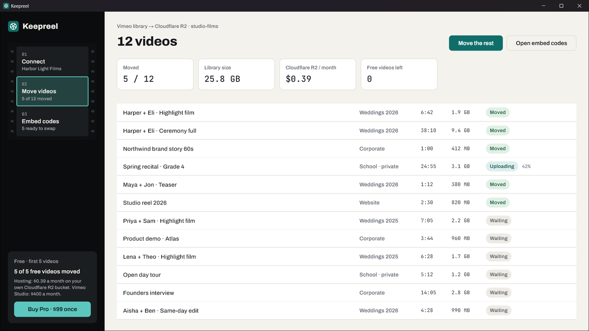
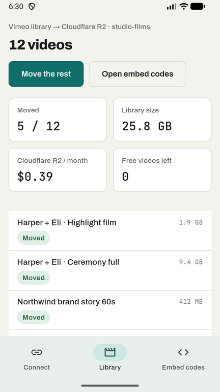

# Keepreel: Host Your Own Videos

Move your Vimeo library to storage you own, with a new embed code for every video. Pay once instead of paying a video host every month. For Windows and Android.

## What it does

Keepreel is for wedding and corporate videographers, small studios, schools and photographers whose client videos are embedded on websites, and whose video hosting bill just jumped.

1. **Connect** your own Vimeo access token and a storage bucket: Cloudflare R2, Backblaze B2 or Bunny Storage.
2. **Move.** Keepreel downloads each video, makes it stream-ready on your computer (HLS in up to three sizes, without re-encoding, so there is no quality loss) and uploads it to your bucket.
3. **Swap.** Copy the new embed code for each video, or export a CSV with every old Vimeo player link next to its new embed code for find-and-replace.

- **No Keepreel server:** files go from Vimeo to your device to your bucket, and your keys stay on your device
- **Unbranded player** hosted in your own bucket, with hard-to-guess links
- **Cheap to run:** Cloudflare R2 storage is about $0.015 per GB a month and views cost nothing
- **Resumes** where it stopped; one video at a time keeps disk use low

| Windows | Android |
|---|---|
|  |  |

## Pricing

- **Windows:** your first 5 videos free. Keepreel Pro is **$99 one-time** for every video in the library. Each key works on 2 computers. No subscription.
- **Android:** free with ads. Your first 5 videos are free; a short ad moves 5 more.

## Good to know

Links are unguessable but not password-protected. There are no view counts, comments or client review tools. Downloading needs a paid Vimeo plan, so move before your renewal date.

## Links

- Website: https://keepreel.pages.dev/
- Microsoft Store: https://apps.microsoft.com/detail/9N48HXGF5CMC
- Google Play: https://play.google.com/store/apps/details?id=com.nktools.keepreel
- Demo video: https://youtu.be/g4jncWRvmYw
- Privacy policy: https://keepreel.pages.dev/privacy/
- Support: anithabheesetty@gmail.com

This repository is the product page for Keepreel. The app's source code is not published here. Keepreel is not affiliated with or endorsed by Vimeo.
